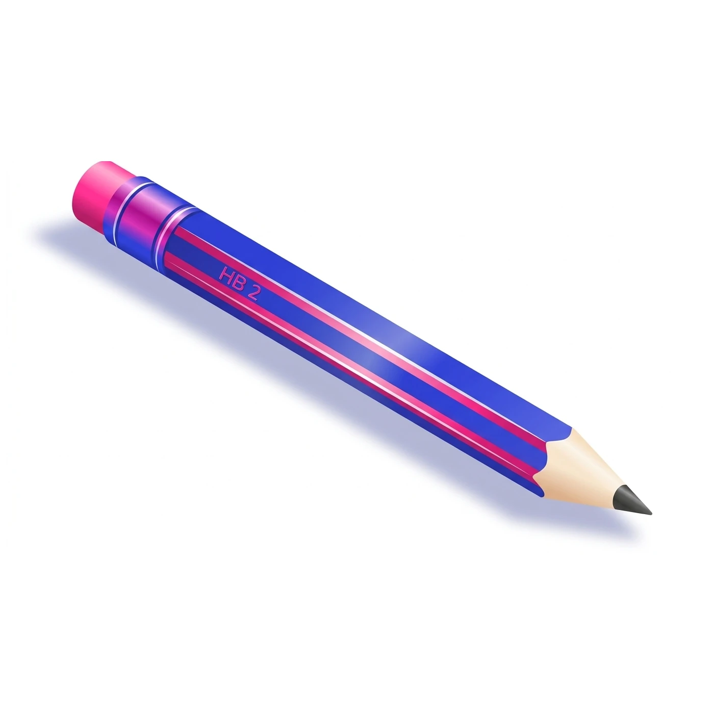
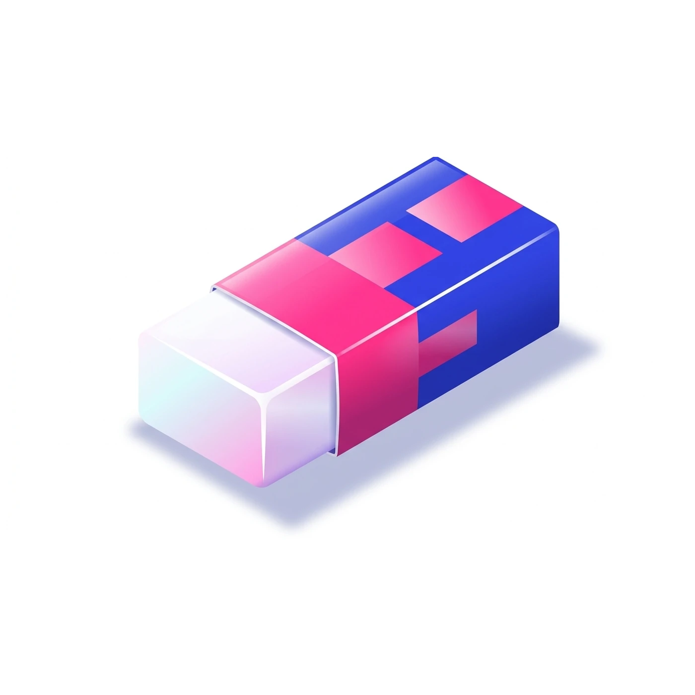
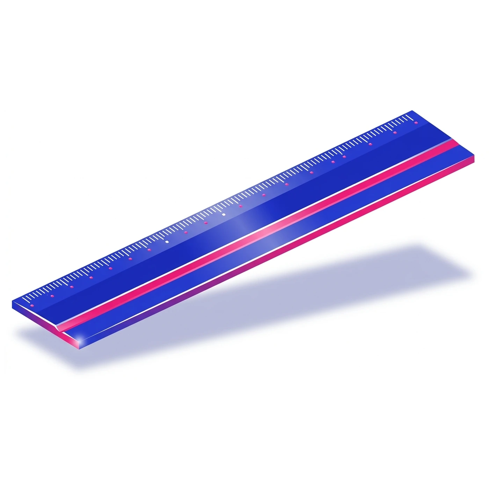
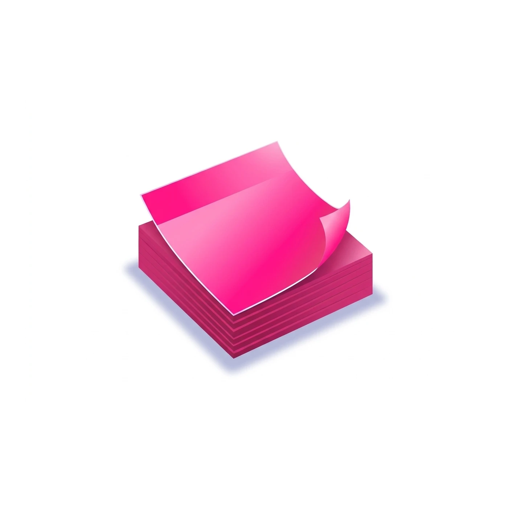
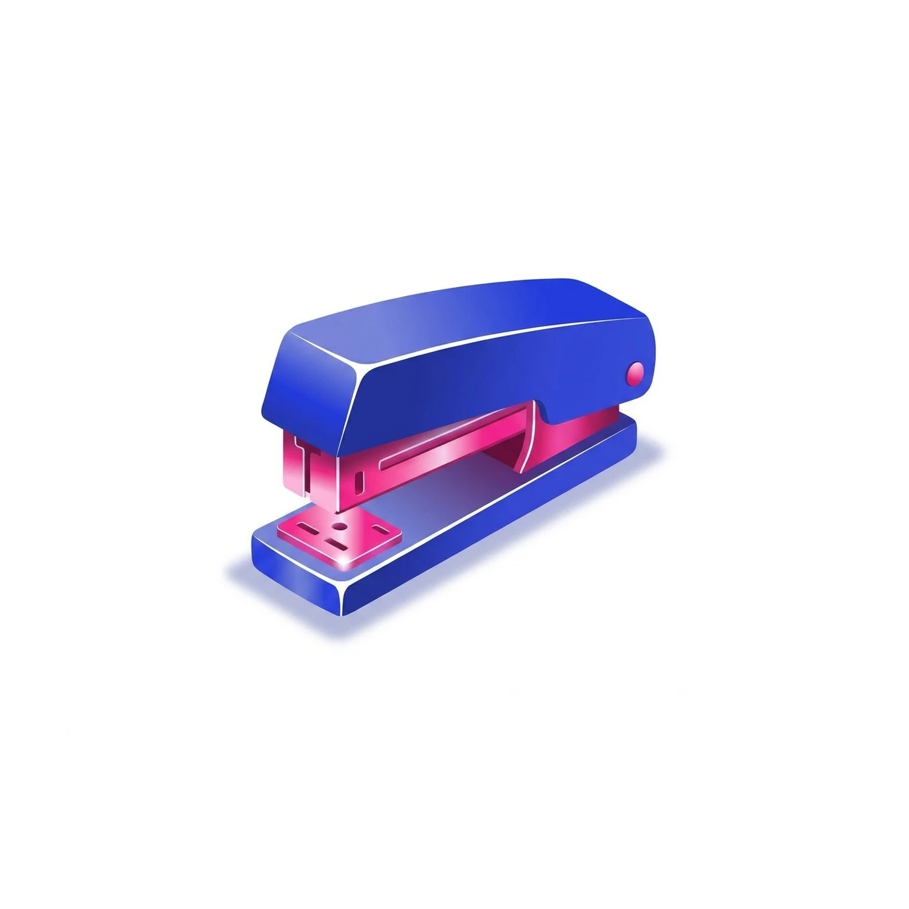
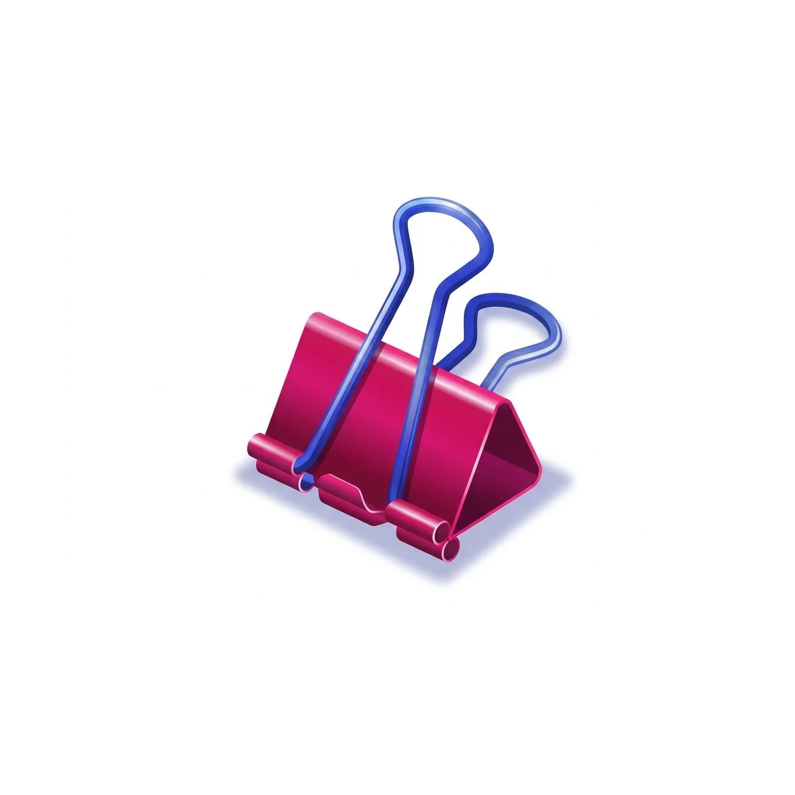
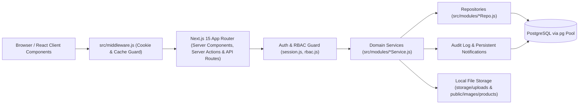
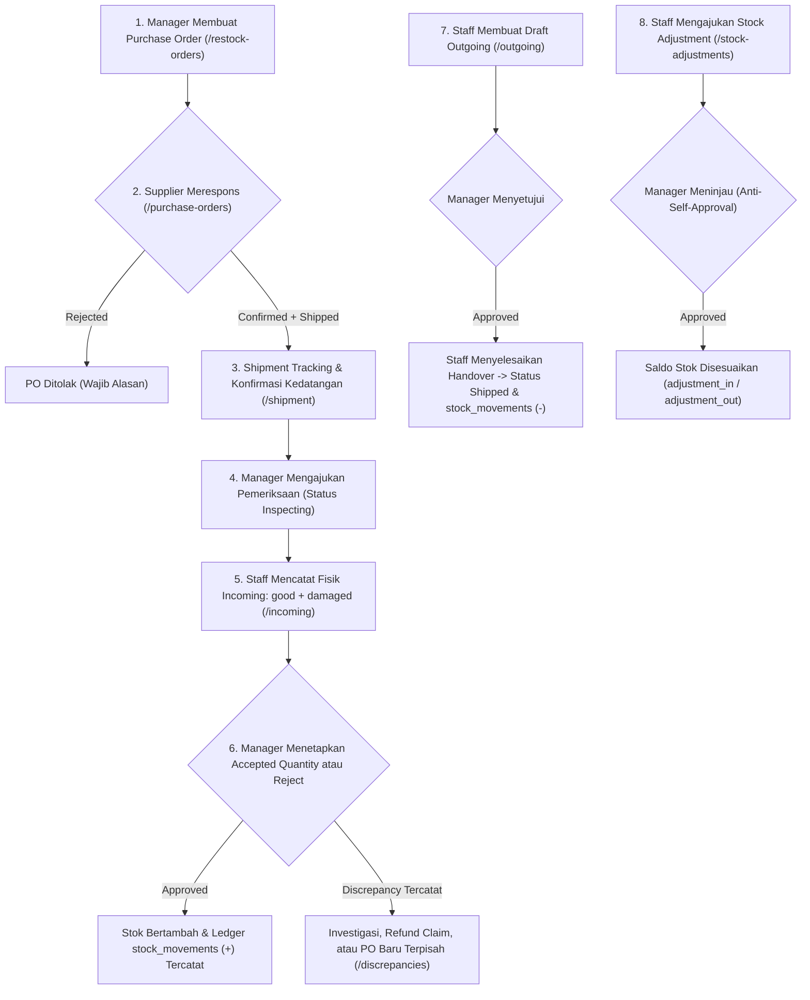
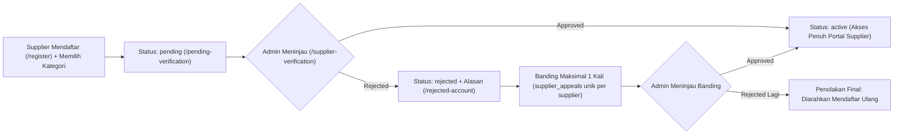

<div align="center">
  
  <h1>Supplify</h1>
  <p><strong>Creative Supplies Warehouse Management System (WMS)</strong></p>
  <p>
    Supplify merupakan sistem manajemen gudang berbasis web yang dirancang untuk memudahkan pengelolaan persediaan, produk, supplier, dan transaksi gudang dalam satu platform terintegrasi. Sistem ini mendukung pemantauan stok, pengadaan barang, serta proses barang masuk dan keluar melalui workflow terstruktur, pembagian hak akses, dan pencatatan aktivitas untuk meningkatkan efisiensi dan akurasi operasional gudang.
  </p>

  <p>
    
    
    
    
    
    
  </p>

  <p>
    <a href="#-tentang-supplify">Tentang</a> •
    <a href="#-aset-visual--pratinjau-media">Visual</a> •
    <a href="#-arsitektur-sistem--alur-kerja">Arsitektur</a> •
    <a href="#-fitur-utama">Fitur</a> •
    <a href="#-role--matriks-rbac">RBAC</a> •
    <a href="#-quick-start">Quick Start</a> •
    <a href="#-api-endpoints">API</a> •
    <a href="#-struktur-proyek">Struktur</a> •
    <a href="#-pengujian">Pengujian</a>
  </p>
</div>

---

> [!NOTE]
> Seluruh dokumentasi di bawah ini mencerminkan kondisi aktual codebase Supplify saat ini, termasuk label UI Bahasa Indonesia untuk status stok (`Habis`, `Kritis`, `Menipis`, `Aman`), pembatasan banding registrasi Supplier maksimal 1 kali, hak akses CRU Manager pada produk, serta skema PostgreSQL terpadu (`database/migrations/schema.sql`).

---

## 📋 Daftar Isi

- [Tentang Supplify](#-tentang-supplify)
- [Aset Visual & Pratinjau Media](#-aset-visual--pratinjau-media)
- [Arsitektur Sistem & Alur Kerja](#-arsitektur-sistem--alur-kerja)
- [Fitur Utama](#-fitur-utama)
- [Role & Matriks RBAC](#-role--matriks-rbac)
- [Tech Stack](#-tech-stack)
- [Quick Start](#-quick-start)
- [Skema Database](#-skema-database)
- [API Endpoints](#-api-endpoints)
- [Struktur Proyek](#-struktur-proyek)
- [Pengujian](#-pengujian)
- [Penyimpanan File & Keamanan](#-penyimpanan-file--keamanan)

---

## 🎯 Tentang Supplify

**Supplify** adalah aplikasi Warehouse Management System (WMS) berbasis web yang dirancang khusus untuk operasional gudang perlengkapan kreatif pada tiga kategori utama: **Stationery (`STA`)**, **Office Supplies (`OFF`)**, dan **Art Supplies (`ART`)**.

Dibangun dengan pola **Modular Monolith** menggunakan Next.js App Router, Supplify mengoordinasikan empat role terautentikasi (**Admin**, **Warehouse Manager**, **Warehouse Staff**, dan **Supplier**) beserta halaman publik untuk **Guest** (`/`). Seluruh mutasi operasional dijalankan di dalam transaksi PostgreSQL (`withTransaction`), mencatat ledger `stock_movements` secara seimbang, menyimpan jejak aktivitas pada `audit_logs`, dan mengirimkan notifikasi persisten lintas role.

### Prinsip Desain Utama

- **Integritas Berbasis Database:** Query SQL terparameterisasi melalui `pg`, penguncian stok transaksional (`lockProductsForUpdate`), penjagaan stok non-negatif, serta validasi saldo ledger (`stock_after = stock_before + quantity_delta`).
- **RBAC Berlapis (Defense-in-Depth):** Pemeriksaan awal cookie sesi pada `src/middleware.js` dipadukan dengan verifikasi sesi dan otorisasi server-side (`requirePermission`, `assertSupplierOwnership`) di setiap Page, Route Handler, dan Server Action.
- **Ketertelusuran Penuh:** Setiap Purchase Order, Shipment, pemeriksaan fisik, penetapan `Accepted Quantity`, klaim Discrepancy/Refund, Stock Adjustment, dan serah terima Outgoing tercatat dalam audit log beserta lampiran bukti operasional.

---

## 🎨 Aset Visual & Pratinjau Media

Supplify menyertakan ilustrasi merek dan aset katalog WebP siap pakai pada `public/images/` yang digunakan di halaman publik (`src/app/page.jsx`), sidebar navigasi, dan data awal produk.

| Portal Guest & Ilustrasi Gudang | Visual Perlengkapan Kreatif |
| :---: | :---: |
|  |  |
| *Digunakan pada bagian hero halaman guest (`src/app/page.jsx`)* | *Digunakan pada bagian kemitraan halaman guest (`src/app/page.jsx`)* |

<details>
<summary><strong>🖼️ Pratinjau Dapat Dibuka: Aset Produk Bawaan Katalog (15 SKU WebP di <code>public/images/products/</code>)</strong></summary>

<br />

| Kategori | SKU | Nama Produk | Pratinjau Aset | Path Publik |
| :--- | :--- | :--- | :---: | :--- |
| **STA** | `STA-001` | Pensil HB 2 |  | `/images/products/11_Pensil_HB_2.webp` |
| **STA** | `STA-002` | Pulpen Gel 0.5 mm |  | `/images/products/12_Pulpen_Gel_0.5mm.webp` |
| **STA** | `STA-003` | Penghapus Putih |  | `/images/products/13_Penghapus_Putih.webp` |
| **STA** | `STA-004` | Penggaris 30 cm |  | `/images/products/14_Penggaris_30cm.webp` |
| **STA** | `STA-005` | Drawing Pen 0.1 mm |  | `/images/products/15_Drawing_Pen_0.1mm.webp` |
| **OFF** | `OFF-001` | Sticky Notes |  | `/images/products/06_Sticky_Notes.webp` |
| **OFF** | `OFF-002` | Stapler |  | `/images/products/08_Stapler.webp` |
| **OFF** | `OFF-003` | Paper Clip |  | `/images/products/07_Paper_Clip.webp` |
| **OFF** | `OFF-004` | Folder Dokumen |  | `/images/products/09_Folder_Dokumen.webp` |
| **OFF** | `OFF-005` | Binder Clip |  | `/images/products/10_Binder_Clip.webp` |
| **ART** | `ART-001` | Sketchbook A4 |  | `/images/products/01_Sketchbook_A4.webp` |
| **ART** | `ART-002` | Watercolor Set |  | `/images/products/02_Watercolor_Set.webp` |
| **ART** | `ART-003` | Acrylic Paint |  | `/images/products/03_Acrylic_Paint.webp` |
| **ART** | `ART-004` | Kuas Lukis |  | `/images/products/04_Kuas_Lukis.webp` |
| **ART** | `ART-005` | Canvas Panel |  | `/images/products/05_Canvas_Panel.webp` |

</details>

---

## 🔄 Arsitektur Sistem & Alur Kerja

### Alur Permintaan Modular Monolith



### Alur Operasional & Onboarding Utama

<details>
<summary><strong>📦 Alur Procurement, Incoming, Discrepancy & Outgoing (Mermaid)</strong></summary>



</details>

<details>
<summary><strong>🛂 Alur Registrasi Supplier, Verifikasi & Banding 1 Kali (Mermaid)</strong></summary>



</details>

---

## ✨ Fitur Utama

### 🔐 Autentikasi, RBAC & Siklus Akun
- **Session Berbasis Database:** Token acak di-hash di tabel `sessions`, disimpan sebagai cookie HTTP-only (`session.js`, `sessionStore.js`, `cookieConfig.js`), dan diverifikasi terhadap status akun aktif.
- **Proteksi Route Berlapis:** `src/middleware.js` memvalidasi keberadaan cookie dan menyetel header `Cache-Control: no-store` pada route terproteksi, sementara server component dan service mengecek izin spesifik lewat `src/lib/auth/rbac.js`.
- **Status Gate & Banding Supplier 1 Kali:** Supplier `pending` diarahkan ke `/pending-verification`; Supplier `rejected` diarahkan ke `/rejected-account` melalui cookie bertanda tangan (`statusNotice`) dan hanya dapat mengajukan **maksimal 1 kali banding** (`uq_supplier_appeals_single_per_supplier`) dengan notifikasi lintas role ke Admin.
- **Manajemen Pengguna & Profil (`/users`, `/profile`):** Admin dapat membuat akun internal (`admin`, `manager`, `staff`) dan mengubah status akun (`active`/`inactive`) disertai pencabutan sesi otomatis; keempat role dapat memperbarui profil pribadinya di `/profile`.

### 📦 Master Produk, Kategori & Status Stok 4 Tingkat
- **Manajemen Kategori (`/categories`):** Tambah, ubah, dan hapus aman kategori (penghapusan ditolak jika masih terhubung ke produk atau supplier).
- **Katalog & Detail Produk (`/products`, `/products/[id]`):** Mengelola SKU, nama, kategori, pilihan satuan terkurasi (`PCS`, `PACK`, `BOX`, `UNIT`, `SET`, `BOTOL`, `RIM`, `LUSIN`, `ROLL`, `DUS`, `LEMBAR`), harga beli, harga jual, lokasi rak, `minimum_stock`, `low_stock_threshold`, serta gambar produk di `public/images/products/`.
- **Hak Akses CRU Manager vs Archive/Delete Admin:** Admin dan Warehouse Manager dapat membuat dan mengedit data produk; soft-archive (`deleted_at`) dan penghapusan permanen aman (hanya jika `stock === 0` dan bebas riwayat transaksi/PO) tetap khusus wewenang Admin.
- **Klasifikasi Status Stok 4 Tingkat:** Dihitung terpusat di `computeProductStockStatus` dan dipetakan melalui `STOCK_STATUS_META`:

| Kondisi | Nilai Internal | Label UI | Warna Indikator |
| :--- | :--- | :--- | :--- |
| `stock === 0` | `Out of Stock` | **Habis** | Neutral |
| `stock > 0` dan `stock <= minimum_stock` | `Severe` | **Kritis** | Danger |
| `stock > minimum_stock` dan `stock <= low_stock_threshold` | `Low` | **Menipis** | Warning |
| `stock > low_stock_threshold` | `Normal` | **Aman** | Success |
| `minimum_stock` belum diatur | `Min. Belum Diatur` | **Min. Belum Diatur** | Neutral |

### 🚚 Procurement, Gudang & Kontrol Persediaan
- **Purchase Order & Pengiriman Supplier (`/restock-orders`, `/purchase-orders`, `/shipment`, `/shipment-history`):** Manager membuat PO ke Supplier terverifikasi (termasuk PO baru terpisah dari laporan Discrepancy); Supplier mengonfirmasi atau menolak PO (wajib alasan), mengisi data kurir/resi Shipment, dan mengonfirmasi kedatangan.
- **Incoming & Pemeriksaan Fisik (`/incoming`, `/incoming/[id]`):** Staff membuat pengajuan Incoming untuk PO berstatus `inspecting` (atau `returned` bila pengajuan sebelumnya ditolak), dijaga aturan maksimal satu Incoming non-rejected per PO, dengan input `good_quantity` + `damaged_quantity` (`good + damaged === jumlah fisik pesanan`). Manager menyetujui `Accepted Quantity` eksplisit (dibatasi jumlah pesanan dan hasil inspeksi), menambah stok aktual, dan memfinalisasi PO (`received` atau `returned`).
- **Outgoing & Handover (`/outgoing`, `/outgoing/[id]`):** Staff membuat draft Outgoing beserta data penerima (`internal`, `customer`, `branch`, `external`, `courier`), Manager menyetujui, lalu Staff menyelesaikan serah terima (`direct` atau `courier`) sehingga status menjadi `shipped` dan stok berkurang secara atomik.
- **Inventory Hub, Stock Movements, Discrepancy & Stock Adjustment (`/inventory`, `/stock-movements`, `/discrepancies`, `/stock-adjustments`):** Hub terpadu 4 tab yang menyatukan ringkasan status stok, ledger `stock_movements` yang tidak dapat diubah, pelacakan Discrepancy & klaim Refund manual ke Supplier (`submitted`, `approved`, `rejected`, `completed`), serta pengajuan Stock Adjustment oleh Staff (ditolak menyetujui sendiri oleh constraint `chk_adjustment_not_self_approval`).

### 🔔 Fitur Pendukung Sistem
- **Pencarian Produk pada Form (`SearchableProductSelect`):** Filter interaktif berdasarkan nama, SKU, dan kategori pada form PO, Outgoing, Discrepancy, dan Stock Adjustment.
- **Lampiran Bukti Operasional (`/api/evidence`):** Unggah dan pratinjau file bukti (`JPEG`, `PNG`, `WEBP`, `PDF`) dengan otorisasi ketat per entitas (`incoming_inspection`, `supplier_shipment`, `supplier_arrival`, `outgoing_handover`, `discrepancy`).
- **Ekspor CSV per Role (`/api/export/[resource]`):** Unduh CSV UTF-8 dengan BOM dan sanitasi formula injection (`=`, `+`, `-`, `@`) untuk `products`, `categories`, `suppliers`, `purchase-orders`, `incoming`, dan `outgoing`.
- **Audit Log & Notifikasi Persisten:** Rekam jejak aktivitas `audit_logs` (`recordAuditEvent`) di `/activity-log` serta notifikasi lonceng persisten di header (`NotificationBell`).

---

## 🛡️ Role & Matriks RBAC

<details>
<summary><strong>Klik untuk melihat rincian izin dan navigasi per role (<code>src/lib/auth/rbac.js</code>)</strong></summary>

<br />

| Kapabilitas / Area | Admin | Warehouse Manager | Warehouse Staff | Supplier |
| :--- | :---: | :---: | :---: | :---: |
| **Dashboard Role (`/dashboard`) & Profil (`/profile`)** | KPI Administrasi Penuh | KPI Operasional Gudang | KPI Tugas Harian | KPI PO & Pengiriman Sendiri |
| **Manajemen Pengguna (`/users`)** | Kelola user internal & status akun | - | - | - |
| **Verifikasi & Banding Supplier (`/supplier-verification`)** | Verifikasi, tolak, tinjau banding 1x | Baca daftar supplier | - | Ajukan banding 1x jika ditolak |
| **Kategori (`/categories`)** | CRUD | CRUD | Baca saja | - |
| **Produk (`/products`)** | Create, Read, Update, Archive, Delete | Create, Read, Update | Baca saja | - |
| **Inventory Hub & Pergerakan Stok (`/inventory`, `/stock-movements`)** | Tab Ringkasan & Pergerakan Stok | Semua 4 tab (Ringkasan, Pergerakan, Discrepancy, Adjustment) | Tab Ringkasan, Discrepancy & Adjustment | - |
| **Purchase Order & Shipment** | Baca semua | Buat PO, Minta Inspeksi, Finalisasi | Baca semua, Inspeksi PO | Konfirmasi/Tolak PO sendiri, Kelola shipment sendiri |
| **Incoming (`/incoming`)** | Baca | Setujui (`Accepted Quantity`) / Tolak | Draft & Pemeriksaan Fisik | - |
| **Outgoing (`/outgoing`)** | Baca | Setujui / Tolak | Draft & Selesaikan Handover | - |
| **Discrepancy & Stock Adjustment** | - | Selesaikan Discrepancy, Klaim Refund, Setujui Adjustment | Laporkan Discrepancy, Ajukan Adjustment | - |
| **Log Aktivitas (`/activity-log`)** | Baca (`/activity-log`) | Izin audit (`AUDIT_READ`) | - | - |
| **Ekspor CSV (`/api/export/[resource]`)** | Semua 6 resource | `products`, `purchase-orders`, `incoming`, `outgoing` | `incoming` & `outgoing` milik sendiri | - |

</details>

---

## 🛠️ Tech Stack

| Layer | Teknologi | Penggunaan di Supplify |
| :--- | :--- | :--- |
| **Framework** | Next.js `^15.5.6` (App Router) | Server Components, Server Actions (`bodySizeLimit: 6mb`), Route Handlers, Middleware |
| **UI & Styling** | React `^19.1.0`, Tailwind CSS `^4.1.14`, `@tailwindcss/postcss`, `lucide-react` | Design system internal (`src/components/ui/`, `src/app/globals.css`), font Inter |
| **Bahasa** | JavaScript / JSX (`"type": "module"`) | Kode server & client terpadu dengan alias `@/*` (`jsconfig.json`) |
| **Database** | PostgreSQL + `pg` `^8.23.1` | Parameterized queries, connection pooling (`src/lib/db/pool.js`), transaksi eksplisit |
| **Keamanan & Auth** | `bcryptjs` `^3.0.2` + Node `node:crypto` | Hashing password, token sesi SHA-256, signed cookie `statusNotice` berbasis HMAC |
| **Storage** | Driver filesystem lokal (`src/lib/storage/localDriver.js`) | Bukti privat di `STORAGE_ROOT` dan gambar produk publik di `public/images/products/` |
| **Testing** | Test runner bawaan Node.js (`node --test`) | 15 suite unit test + 4 suite PostgreSQL integration test |

---

## 🚀 Quick Start

### Prasyarat Sistem

- **Node.js** (mendukung ESM native dan `node --test`, mis. Node 20+) & **npm**
- **PostgreSQL** (instance lokal atau server yang dapat diakses)
- **Git**

### 1. Clone repository

```bash
git clone https://github.com/zahwayy/SUPPLIFY.git
cd SUPPLIFY
```

### 2. Install dependensi

```bash
npm install
```

### 3. Konfigurasi environment variables (`.env.local`)

Salin file template `.env.example` menjadi `.env.local` di root proyek:

```powershell
# Windows (PowerShell)
Copy-Item .env.example .env.local
```

```cmd
:: Windows (Command Prompt)
copy .env.example .env.local
```

```bash
# macOS / Linux
cp .env.example .env.local
```

Buat secret acak 64 karakter hex untuk `SESSION_SECRET` menggunakan Node.js:

```bash
node -e "console.log(require('crypto').randomBytes(32).toString('hex'))"
```

Buka `.env.local` dan sesuaikan variabel berikut sesuai [`.env.example`](.env.example):

| Variabel | Fungsi | Contoh Placeholder |
| :--- | :--- | :--- |
| `NODE_ENV` | Mode runtime (`development` / `production`) | `development` |
| `APP_URL` | URL dasar aplikasi | `http://localhost:3000` |
| `DATABASE_URL` | URI koneksi PostgreSQL lokal | `postgresql://postgres:<password_anda>@localhost:5432/supplify_db` |
| `SESSION_SECRET` | Secret acak (`>= 32` karakter) untuk signing token | `<tempel_hasil_generate_hex>` |
| `SESSION_TTL_DAYS` | Masa berlaku sesi login (hari) | `7` |
| `STORAGE_ROOT` | Direktori lokal privat untuk file bukti | `./storage/uploads` |
| `MAX_UPLOAD_SIZE_MB` | Batas maksimum ukuran file bukti | `5` |

> [!TIP]
> **Checklist PostgreSQL untuk Pengguna Windows:** Pastikan service PostgreSQL di Windows sudah berjalan (`Services`), port sesuai (`5432` default), dan karakter khusus pada `<password_anda>` di `DATABASE_URL` di-encode sebagai URL (misalnya `@` menjadi `%40`).

> [!WARNING]
> Jangan pernah melakukan commit terhadap `.env.local` atau menuliskan kredensial database dan `SESSION_SECRET` asli ke file yang masuk Git.

### 4. Buat & inisialisasi database PostgreSQL

Buat database baru bernama `supplify_db`, lalu jalankan skema dan dataset awal secara berurutan:Buat database baru bernama supplify_db. Pastikan database masih kosong sebelum menjalankan script inisialisasi.

Jalankan file schema dan dataset awal secara berurutan sesuai instruksi berikut.

> [!IMPORTANT]
> Jalankan `schema.sql` hanya pada database baru yang masih kosong. Jangan menimpa database yang sudah berisi data operasional.

### 5. Akun uji lokal dari `seed.sql`

[`database/seeds/seed.sql`](database/seeds/seed.sql) menyediakan empat akun uji aktif (`admin@supplify.local`, `manager@supplify.local`, `staff@supplify.local`, `supplier@supplify.local`), satu supplier terverifikasi (`PT Kertas & Kreasi Nusantara`), 3 kategori (`STA`, `OFF`, `ART`), dan 15 SKU awal. Silakan lihat komentar header pada file lokal `database/seeds/seed.sql` untuk mengetahui kata sandi pengembangan akun-akun uji tersebut.

### 6. Jalankan development server

```bash
npm run dev
```

## 🗄️ Skema Database

[`database/migrations/schema.sql`](database/migrations/schema.sql) menyatukan seluruh migrasi menjadi **19 tabel** dalam satu blok transaksi `BEGIN; ... COMMIT;` tanpa klausa `IF NOT EXISTS`.

<details>
<summary><strong>Klik untuk melihat rincian 19 tabel, constraint bisnis & indeks</strong></summary>

<br />

| Bagian | Daftar Tabel | Constraint & Indeks Utama |
| :--- | :--- | :--- |
| **1. Authentication & Partners** | `users`, `sessions`, `suppliers`, `supplier_appeals` | Email & session `token_hash` unik; kolom `users.phone`; `uq_supplier_appeals_single_per_supplier` (maksimal 1 banding per supplier) |
| **2. Master Data** | `categories`, `supplier_categories`, `products` | Harga & `stock` non-negatif; `chk_products_threshold_order` (`low_stock_threshold > minimum_stock`); indeks parsial aktif `idx_products_active` |
| **3. Procurement & Shipping** | `purchase_orders`, `purchase_order_items`, `shipment_details` | `po_code` unik; FK sirkular `source_discrepancy_id` ke `discrepancy_reports`; item unik per produk dalam satu PO |
| **4. Warehouse Transactions** | `transactions`, `transaction_items`, `handover_details` | `chk_transaction_po_type` & `chk_transaction_status_type`; `uq_transactions_single_active_incoming_po` (maksimal 1 Incoming pending/approved per PO) |
| **5. Discrepancy & Stock Control** | `discrepancy_reports`, `stock_adjustments`, `stock_movements` | `chk_discrepancy_source_fk`; `chk_adjustment_not_self_approval` (`reviewed_by <> requested_by`); `chk_movement_stock_balance` & `chk_movement_source_type` |
| **6. Evidence, Audit & Notifications** | `evidence_files`, `audit_logs`, `notifications` | `chk_evidence_source_fk`; `idx_audit_entity_date`; `idx_notifications_recipient_unread_date` |

</details>

---

## 🌐 API Endpoints

Selain Next.js Server Actions (`src/modules/*/*Actions.js`), Supplify menyediakan Route Handler berikut di bawah `src/app/api/`:

<details>
<summary><strong>Klik untuk melihat daftar Route Handler, metode HTTP & aturan otorisasi</strong></summary>

<br />

| Metode | Endpoint | Akses | Fungsi | Sumber |
| :--- | :--- | :--- | :--- | :--- |
| `GET` | `/api/health` | Publik | Memeriksa koneksi PostgreSQL (`SELECT 1`, nama database & skema) | [`src/app/api/health/route.js`](src/app/api/health/route.js) |
| `GET` | `/api/auth/me` | Terautentikasi | Mengembalikan profil user dari sesi aktif (`Cache-Control: private, no-store`) | [`src/app/api/auth/me/route.js`](src/app/api/auth/me/route.js) |
| `GET` | `/api/admin/rbac-check` | Admin (`USERS_MANAGE`) | Memvalidasi status otorisasi peran Admin | [`src/app/api/admin/rbac-check/route.js`](src/app/api/admin/rbac-check/route.js) |
| `POST` | `/api/evidence` | Role operasional berwenang | Mengunggah file bukti multipart (`file`, `entityType`, `entityId`, `description`) | [`src/app/api/evidence/route.js`](src/app/api/evidence/route.js) |
| `GET` | `/api/evidence/[id]` | Pembaca entitas berwenang | Mengalirkan file bukti privat secara inline dengan header `nosniff` | [`src/app/api/evidence/[id]/route.js`](src/app/api/evidence/[id]/route.js) |
| `DELETE` | `/api/evidence/[id]` | Pengunggah/reviewer berwenang | Menghapus file bukti dan metadata tersimpan | [`src/app/api/evidence/[id]/route.js`](src/app/api/evidence/[id]/route.js) |
| `GET` | `/api/export/[resource]` | RBAC ekspor per role | Mengunduh CSV tersanitasi (`products`, `categories`, `suppliers`, `purchase-orders`, `incoming`, `outgoing`) | [`src/app/api/export/[resource]/route.js`](src/app/api/export/[resource]/route.js) |
| `GET` | `/api/products/[id]/image` | `PRODUCTS_READ` | Endpoint fallback untuk membaca gambar produk legacy di `STORAGE_ROOT` | [`src/app/api/products/[id]/image/route.js`](src/app/api/products/[id]/image/route.js) |

</details>

---

## 📁 Struktur Proyek

<details>
<summary><strong>Klik untuk menelusuri struktur direktori terverifikasi</strong></summary>

```text
SUPPLIFY/
├── database/
│   ├── migrations/schema.sql             # Skema PostgreSQL terpadu (19 tabel)
│   └── seeds/seed.sql                    # Seed idempoten: 4 user, 1 supplier, 3 kategori, 15 SKU
├── public/
│   ├── .gitkeep
│   └── images/
│       ├── logo-supplify.png
│       ├── warehouse-illustration.png
│       ├── box-illustration.png
│       └── products/                     # 15 gambar bawaan .webp + lokasi upload gambar produk baru
├── src/
│   ├── middleware.js                     # Pengecekan cookie sesi & header cache-control no-store
│   ├── app/
│   │   ├── globals.css                   # Import Tailwind v4 & token tema Supplify
│   │   ├── layout.jsx                    # Root HTML layout & font Inter
│   │   ├── page.jsx                      # Halaman publik guest
│   │   ├── unauthorized/page.jsx         # Halaman akses ditolak (403)
│   │   ├── (auth)/                       # layout, login, register, pending-verification, rejected-account
│   │   ├── (dashboard)/                  # Route terproteksi: layout, loading, error, dashboard, profile,
│   │   │                                 # products, products/[id], categories, inventory, stock-movements,
│   │   │                                 # stock-adjustments, discrepancies, discrepancies/[id],
│   │   │                                 # purchase-orders, purchase-orders/[id], restock-orders,
│   │   │                                 # shipment, shipment-history, incoming, incoming/[id],
│   │   │                                 # outgoing, outgoing/[id], supplier-verification, users, activity-log
│   │   └── api/                          # health, auth/me, admin/rbac-check, evidence, export, products/[id]/image
│   ├── components/
│   │   ├── ui/                           # 15 komponen dasar UI (Badge, Button, Card, Dialog, Modal, Table, dll.)
│   │   ├── shared/                       # 9 komponen lintas fitur (PageHeader, StatusPill, EvidencePanel, dll.)
│   │   ├── layout/                       # DashboardLayout, Sidebar, Header, NotificationBell, MainContent
│   │   ├── icons/                        # SupplifyLogo.jsx
│   │   └── <domain>/                     # auth, users, profile, suppliers, categories, products, inventory,
│   │                                     # purchase-orders, incoming, outgoing, discrepancies, adjustments, audit, dashboard
│   ├── lib/
│   │   ├── auth/                         # cookieConfig, password, rbac, session, sessionStore, statusNotice
│   │   ├── constants/                    # errors, navigation, roles, statuses, units
│   │   ├── db/pool.js                    # PostgreSQL pool & helper transaksi
│   │   ├── storage/                      # index.js, localDriver.js
│   │   ├── utils/                        # csv, format, labels, logger, productImage, productSearch, response
│   │   └── validation/common.js
│   └── modules/                          # adjustments, audit, auth, categories, dashboard, discrepancies,
│                                         # export, files, incoming, inventory, notifications, outgoing,
│                                         # products, purchase-orders, suppliers, users
├── tests/
│   ├── unit/                             # 15 file unit test
│   └── integration/                      # 4 file PostgreSQL integration test
├── .env.example
├── .gitignore
├── jsconfig.json
├── next.config.mjs
├── package.json
├── postcss.config.mjs
└── README.md
```

</details>

---

## 🧪 Pengujian

Supplify menyediakan **19 test suite** menggunakan test runner bawaan Node.js (`node --test tests/**/*.test.js`): **15 suite unit test** (42 kasus uji) dan **4 suite PostgreSQL integration test** (4 kasus uji), dengan total **46 kasus uji terdefinisi**.

- Seluruh unit test berjalan tanpa membutuhkan koneksi database.
- Integration test memerlukan PostgreSQL yang aktif dan terkonfigurasi lewat `DATABASE_URL` di `.env.local`; jika tidak tersedia, integration test akan otomatis dilewati (*skipped*).
- Status kelulusan (*pass/fail*) bergantung pada kondisi environment lokal masing-masing dan tidak diasumsikan otomatis dari jumlah kasus uji di atas.

```bash
# Perintah bawaan npm test (unit test + integration suite paralel)
npm test
```

> [!TIP]
> Saat menjalankan integration test terhadap database PostgreSQL lokal yang aktif, jalankan secara berurutan agar proses cleanup pada tabel `categories` antar file integrasi tidak saling bertabrakan:
>
> ```bash
> node --test --test-concurrency=1 tests/**/*.test.js
> ```

<details>
<summary><strong>Klik untuk melihat daftar lengkap 19 test suite</strong></summary>

- **Unit Tests (`tests/unit/`):**
  - `controlled-fixes.test.js`, `final-wms.test.js`, `labels.test.js`, `middleware.test.js`, `navigation.test.js`, `password.test.js`, `phase5-validation.test.js`, `pool.test.js`, `rbac.test.js`, `seed.test.js`, `status-notice.test.js`, `storage.test.js`, `usability-enhancements.test.js`, `validation.test.js`, `workflow-and-csv.test.js`
- **Database Integration Tests (`tests/integration/`):**
  - `auth-db.test.js`: registrasi Supplier, status gate, dan siklus hidup sesi
  - `phase5-workflows.test.js`: alur PO -> Incoming Accepted Quantity -> Received/Returned -> Outgoing Shipped -> Adjustment -> ekspor CSV
  - `product-manager-rbac.test.js`: hak akses CRU produk Manager serta pembatasan archive dan delete
  - `usability-workflows.test.js`: siklus banding registrasi Supplier, notifikasi lintas role, edit profil, serta aturan gambar dan penghapusan produk

</details>

---

## 🔒 Penyimpanan File & Keamanan

- **Lampiran Bukti Operasional (Privat):** Dokumen bukti inspeksi, pengiriman, kedatangan, serah terima, dan discrepancy disimpan di luar `public/` di bawah `STORAGE_ROOT` (`./storage/uploads`) dan hanya dapat diakses melalui endpoint terautentikasi `/api/evidence/[id]`.
- **Gambar Produk (Publik):** Gambar katalog produk (`01_Sketchbook_A4.webp` hingga `15_Drawing_Pen_0.1mm.webp` serta gambar SKU yang diunggah melalui form) disimpan di `public/images/products/`, sementara `saveProductImageFile` melindungi ke-15 aset `.webp` bawaan agar tidak ikut terhapus saat produk diperbarui atau dihapus.
- **Kebersihan Git:** `.gitignore` mengecualikan `.env`, `.env.*` (tetap menyertakan `.env.example`), `/storage/`, `/node_modules/`, `/.next/`, dan `/temp-git/`.
- **Inisialisasi Database Aman:** Jalankan `database/migrations/schema.sql` hanya saat menyiapkan database baru yang kosong agar data operasional yang ada tidak tertimpa.
